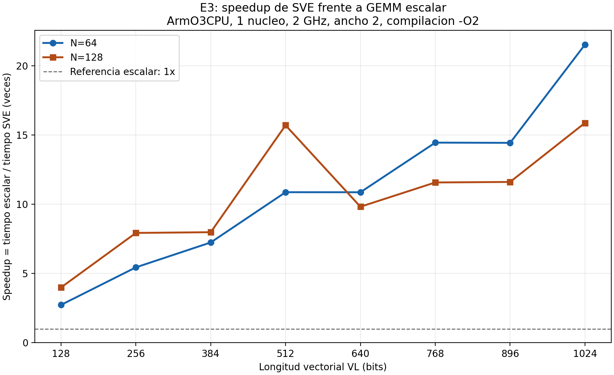

# Arquitecturas paralelas para la multiplicación de matrices en gem5
Instituto Tecnológico de Costa Rica (TEC) · Arquitectura de Computadoras · Proyecto grupal #2

Este repositorio contiene los diversos programas, configuraciones, scripts y evidencias las cuales son necesarias para estudiar el rendimiento de la 
multiplicación de matrices densas (GEMM, C = A × B) utilizando la herramienta de  simulacion gem5, en modo System-call Emulation (SE) sobre 
arquitectura AArch64 implementada con ARMv8.

Asimismo, el presente trabajo analiza el paralelismo a nivel de instrucciones, el ancho superescalar y el búfer de reordenamiento (ROB), 
la vectorización Arm SVE, la ejecución multinúcleo y la coherencia de memoria. El objetivo final es recomendar una arquitectura respaldada 
por las diversas mediciones de GEMM y teniendo en cuenta una restricción de costo.

Estado del proyecto: entorno del Docker ARM preparado y el GEMM escalar validado. Asimismo, el barrido de E2 esta completado y publicado: 24 
corridas, las cuales corresponden a 12 configuraciones para un tamano de N=64 y 12 para un tamano de N=128.

Por otra parte, la extracción de metricas a CSV, el analisis y los graficos de E2 permanecen pendientes. E2 todavía no se puede considerar como 
terminado en su totalidad.

Por otro lado, la validacion funcional de GEMM SVE esta completada en el simulador de gem5 con un nucleo ArmO3CPU. Ademas, se publicaron 16 pruebas para
un tamano de N=16 y N=17, utilizando las longitudes vectoriales de 128 a 1024 bits en incrementos de 128 bits cada una de ellas. A su vez, todas terminaron
con la impresion en pantalla del CHECK=PASS y  errores=0.

El experimento E3 esta en curso. Asimismo, la implementacion y la validacion funcional de GEMM SVE estan totalmente completadas. A su vez, también esta publicado 
el barrido de rendimiento. la cual consta de 32 corridas y son correspondientes a 16 para un tamano de  N=64 y 16 para un tamano de N=128.

Asimismo, para cada uno de los tamanos se ejecutaron las versiones escalar y SVE con longitudes vectoriales de 128, 256, 384, 512, 640, 768, 896 y 1024 bits. 
De la misma manera, cada pareja escalar/SVE utilizara la misma configuracion de hardware.

La extraccion de metricas de la ROI y el calculo del speedup de E3 estan completados. De la misma manera, los resultados incluyen 32 corridas y 16 comparaciones
escalar/SVE, disponibles en la siguiente ruta: `results/e3/summary/`.

Por otra parte los graficos estan completados y el analisis inicial esta documentado. Permanece pendiente completar la explicacion microarquitectonica.

Finalmente, las secciones 6 y 7 describen la preparacion y validacion del entorno. A su vez, la seccion 8 explica como ejecutar o verificar el 
barrido de E2.

La documentacion detallada se puede observar y analizar en:
[Experimento E2: arquitectura superescalar](docs/experimento_superescalar.md).

# Tabla de contenido
1. Integrantes
2. Objetivos y experimentos
3. Distribución del trabajo
4. Tecnologías y requisitos
5. Estructura del repositorio
6. Instalación paso a paso
7. Compilación y validación
8. Ejecución de los experimentos
9. Resultados y reproducibilidad
10. Trabajo colaborativo y documentación
11. Estado y entregables


### 1) Integrantes
El presente proyecto es desarrollado por los siguientes estudiantes:
- Paulina Camacho
- Sary Vargas
- Tomás Campos
- Steven Loaiza


### 2) Objetivos y experimentos
Se utilizan programas disenados utilizando el lenguage de programacion C, matrices float de tamaño N × N y compilación estática AArch64. 
De la misma manera, los tamaños oficiales principales son N = 64 y N = 128. Por otra parte, las mediciones se realizan sobre la región de 
interés (ROI), marcada mediante m5_reset_stats() y m5_dump_stats().


| Experimento | Qué se estudia | Variantes y métricas principales | Liderazgo |
| --- | --- | --- | --- |
| **E1: línea base** | Procesadores TimingSimple, Minor y O3 | 1 núcleo; ciclos, IPC, CPI y fallos de caché L1D/L2 | Equipo completo |
| **E2: superescalar** | Paralelismo a nivel de instrucciones | Anchos 1, 2, 4 y 8; ROB 32, 64 y 192; IPC, ocupación IQ/ROB y predicción | Paulina Camacho |
| **E3: vectorial** | Extensiones SVE | Escalar frente a SVE; VL de 128, 256, 384, 512, 640, 768, 896 y 1024 bits, ciclos, instrucciones y *speedup* | Steven Loaiza |
| **E4: multinúcleo** | Memoria compartida y escalabilidad | 1, 2, 4 y 8 núcleos O3; *speedup*, eficiencia y fallos L2 | Sary Vargas |
| **E5: coherencia** | MESI, MOESI y falso compartido | `MESI_Two_Level` y `MOESI_CMP_directory`; invalidaciones, mensajes y latencias | Tomas Campos |
| **E6: integración** | Selección de arquitectura | Al menos 6 configuraciones con costo ≤ 32 y GEMM con `N = 128` | Equipo completo |


Modelo de costo del enunciado:
Costo = # de núcleos × (ancho_de_emisión / 2 + VL(longitud_vectorial)_en_bits / 128)
Costo máximo = 32 unidades

De la misma manera, la elección final debe considerar resultados medidos, costo y rendimiento/costo; no basta con solamente  seleccionar la 
configuración de más recursos.


### 3) Distribución del trabajo
Esta sección describe qué aporta cada rol/encargado al repositorio, no es solamente una lista de instrucciones para ejecutar manualmente. De la misma
es importante indicar que las guías detalladas permanecen en docs/ y en los documentos de apoyo del grupo.


| Rol | Responsabilidad técnica | Archivos y evidencias principales |
| --- | --- | --- |
| **Paulina Camacho** | Organizar Git/GitHub, preparar gem5 ARM, establecer el entorno común y liderar **E2**. Participar en E1 y E6. |  |
| **Steven Loaiza** | Desarrollar/validar los benchmarks, automatizar simulaciones y liderar **E3 (SVE)**. Facilitar programas a C y D; participar en E1 y E6. |  |
| **Sary Vargas** | Liderar **E4**, evaluar 1/2/4/8 núcleos, calcular eficiencia y estimar la fracción serial con Amdahl. Coordinar el avance de resultados E1–E3. | |
| **Tomas Campos** | Liderar **E5**, comparar protocolos de coherencia y cuantificar el falso compartido, con y sin relleno. |  |


Actividades compartidas: E1, E6, revisión de resultados, informe IEEE, presentación/video, coevaluación y actividades individuales de 
aprendizaje continuo AC1–AC4. Todos deben poder explicar los resultados del equipo.

### 4) Tecnologías y requisitos
- Ubuntu nativo o en WSL2 (entorno de trabajo propuesto).
- gem5
- GCC, SCons, Python 3, Bash, Git y GitHub.
- El compilador cruzado aarch64-linux-gnu-gcc y la biblioteca libm5.a de gem5.
- matplotlib para poder producir las diversas gráficas, qemu-user es opcional ya que es util para validar los diversos binarios ARM sin medir rendimiento.
- Espacio de disco y memoria suficientes para compilar gem5, asimismo la capacidad requerida depende del equipo y del nivel de paralelismo de la compilación respectiva.

#### Entorno compartido del Docker
El entorno está disponible como una imagen Docker ya compilada. Asimismo, para usarlo, cada integrante necesita Docker funcionando y la 
herramienta de Git, de la misma manera no necesita instalar gem5, SCons ni el compilador AArch64 por separado en Ubuntu.

| Elemento | Configuración |
| --- | --- |
| Imagen publicada | `ghcr.io/pauli-0709/proyecto2-gem5:24.1.0.1-env2` |
| Plataforma de la imagen | `linux/amd64` |
| Sistema base | Ubuntu 22.04 |
| Versión gem5 | 24.1.0.1 |
| Commit gem5 | `c9625ce9cc5b5a90a38327de5ac0e1870974af5e` |
| Protocolos compilados | `MESI_Two_Level` y `MOESI_CMP_directory` |
| Compilador incluido | `aarch64-linux-gnu-gcc` |

De la misma manera, es importante indicar que la imagen corre en un equipo x86-64 y gem5 simula ARM. Por ende se requiere espacio para las capas 
descomprimidas y los resultados. Asimismo además de memoria RAM suficiente para las diversas simulaciones. A su vez, la descarga evita repetir 
la compilación del simulador en forma independiente.

### 5) Estructura del repositorio

```text
Proyecto_2_Arqui/
├── README.md
├── docker/       # Entorno y compilación de gem5
├── docs/         # Plan del equipo y documentacion
├── src/          # Programas de los distintos experimentos
├── configs/      # Configuraciones de las diversas simulaciones
├── scripts/      # Validacion, ejecucion y analisis
├── tests/        # Programas de prueba del entorno
├── results/      # Evidencias, estadisticas, CSV y graficos del proyecto
└── report/       # Informe tecnico y materiales de exposicion
```

Por otra parte, la carpeta configs/ contiene la configuracion superescalar de E2. Asi como, los scripts de ejecucion individual y barrido estan 
implementados en la carpeta scripts/. Por otra parte, la carpeta report/ conserva la documentacion inicial del informe.

Archivos del entorno Docker y sus pruebas:

| Ruta | Función |
| --- | --- |
| `docker/Dockerfile` | Receta única: instala dependencias, luego compila MESI/MOESI y finalmente se agrega las rutas `build/` del enunciado del proyecto. |
| `docker/ARM_MESI.defconfig` | Configuración ARM con MESI. |
| `docker/ARM_MOESI.defconfig` | Configuración ARM con MOESI. |
| `scripts/arm_env.sh` | Abre el contenedor y luego se conecta el repositorio local con `/work`. |
| `tests/environment/hola.c` | Programa de prueba que lo que realiza es una impresion de `HOLA_ARM_OK`. |
| `bin/` | Ejecutables locales generados los cuales no estan destinados a Git. |
| `results/environment/` | Configuraciones y estadísticas de las pruebas. |

### 6) Instalacion paso a paso

#### 6.1. Preparar Ubuntu

Es importante mencionar que los comandos de esta sección se ejecutan en la terminal de Ubuntu, fuera del contenedor.

En primer lugar, se debe comprobar que el Docker esté correctamente instalado y que el mismo siga funcionando:

```bash
sudo docker version
sudo docker run --rm hello-world
```

Continuamente si el Docker no está instalado, seguir la guía oficial:
https://docs.docker.com/engine/install/ubuntu/

Es importante mencionar que si se utiliza Ubuntu en WSL2 con Docker Desktop, habilitar la integración con esa distribución.

En segundo lugar, instalar Git si hace falta:

```bash
sudo apt update
sudo apt install -y git
```

#### 6.2. Clonar el repositorio

En primer lugar, si todavía no se tiene el proyecto:

```bash
cd ~
git clone https://github.com/Pauli-0709/Proyecto_2_Arqui.git
cd Proyecto_2_Arqui
```

Importante si el repositorio ya está clonado, entrar en su carpeta existente.

Finalmente, lsos siguientes pasos se realizan desde la raíz del repositorio, donde esta alogado el archivo README.md y las carpetas docker, 
scripts y tests.

#### 6.3. Descargar la imagen

En primer lugar, la imagen contiene gem5 ya compilado para ARM con los protocolos del proyecto los cuales son el  MESI y el MOESI. Asimismo para 
descargarla, ejecutar el siguiente comando:

```bash
sudo docker pull --platform linux/amd64 \
  ghcr.io/pauli-0709/proyecto2-gem5:24.1.0.1-env2
```

Esperar a que termine la descarga y vuelva a aparecer el indicador de la terminal.

#### 6.4. Entrar al contenedor

```bash
bash scripts/arm_env.sh
```

Esta linea de comando tiene un script que abre una terminal dentro del contenedor utilizando la imagen env2. De la misma manera, el repositorio de Ubuntu se 
conecta con la carpeta `/work`.

Por ejemplo, un archivo guardado dentro del contenedor en `/work/results/` también aparece en la carpeta `results/` del repositorio de Ubuntu.

IMPORTANTE: A partir de este punto, los comandos de la sección 7 se ejecutan dentro del contenedor. NO ES necesario volver a compilar gem5.

### 7) Compilacion y validacion

#### 7.1. Comprobar los simuladores

En primer lugar, dentro del contenedor, entrar en la carpeta de gem5:

```bash
cd /opt/gem5
```

En segundo lugar, comprobar los dos ejecutables:

```bash
build/ARM_MESI/gem5.opt --build-info
build/ARM_MOESI/gem5.opt --build-info
```

Ambos deben mostrar gem5 24.1.0.1. El primero debe indicar el protocolo MESI_Two_Level y el segundo MOESI_CMP_directory.

#### 7.2. Compilar el programa de prueba

Es importante mencionar que el ejemplo del profesor requiere un archivo hola.c y lo compila para ARM. En este repositorio se utiliza 
`tests/environment/hola.c`, el cual tiene como objetivo imprimir el mensaje `HOLA_ARM_OK`.

En primer lugar, compilarlo dentro del contenedor:

```bash
mkdir -p /work/bin

aarch64-linux-gnu-gcc -O2 -static \
  /work/tests/environment/hola.c \
  -o /work/bin/hola_arm
```

En segundo lugar, comprobar el archivo generado:

```bash
file /work/bin/hola_arm
```

Finalmente se debe identificarse como un ejecutable AArch64 con enlace estático. Este programa se ejecutará mediante gem5.

#### 7.3. Ejecutar la simulación

En primer lugar, crear una carpeta de resultados para la prueba:

```bash
cd /opt/gem5

salida="/work/results/environment/hola_$(date +%Y%m%d_%H%M%S)"
mkdir -p "$salida"
```

En segundo lugar, ejecutar:

```bash
build/ARM_MESI/gem5.opt -d "$salida" \
  configs/deprecated/example/se.py \
  --cpu-type=ArmTimingSimpleCPU \
  --caches --l2cache --mem-size=512MiB \
  -c /work/bin/hola_arm
```

Explicacion tecnica del anterior comandoo:

- `build/ARM_MESI/gem5.opt` inicia el simulador.
- `-d "$salida"` selecciona la carpeta de resultados.
- `se.py` configura la simulación en modo SE.
- `-c /work/bin/hola_arm` selecciona el programa compilado.

Es importante mencionar que la opción `-d` debe colocarse antes de `se.py`. A su vez, se guardaran los resultados en `/work` porque es la 
carpeta del repositorio y la misma permite conservarlos al cerrar el contenedor.

#### 7.4. Comprobar el resultado

Inmediatamente después de la simulación, ejecutar:

```bash
echo "Código de salida: $?"
test -s "$salida/stats.txt" && echo "Estadísticas generadas"
```

La prueba debe imprimir `HOLA_ARM_OK`, terminar normalmente, y poder mostrar el código de salida `0` y generar un archivo `stats.txt` no vacío.

Para consultar las CPU disponibles:

```bash
build/ARM_MESI/gem5.opt \
  -d /work/results/environment/lista_cpu \
  configs/deprecated/example/se.py --list-cpu-types
```

#### 7.5. Salir del contenedor

```bash
exit
```

Este comando te devuelve al entorno de Ubuntu y continuamente se pueden consultar los resultados:

```bash
ls results/environment
```

La imagen y los resultados permanecen guardados. Para volver a entrar en otro momento, ejecutar `bash scripts/arm_env.sh` desde el repositorio.

### 8) Ejecucion de los experimentos

#### E2: arquitectura superescalar

El barrido utiliza la funcion GEMM escalar con un nucleo ARM O3 y tiene en cuenta las siguientes caracteristicas:

| Parametro | Valores |
| --- | --- |
| Tamano de matriz N | 64 y 128 |
| Ancho del pipeline | 1, 2, 4 y 8 |
| Entradas del ROB | 32, 64 y 192 |

Asimismo, son 12 configuraciones distintas por tamano y 24 corridas en total.

Los siguientes comandos se ejecutan desde la raiz del repositorio en Ubuntu, fuera del docker.
NOTA: se requiere del Docker funcionando y la imagen env2 descargada segun lo especificado en la seccion 6.

**Ejecutar o verificar el barrido completo:**

```bash
bash scripts/arm_env.sh bash scripts/barrido_superescalar.sh 64 &&
bash scripts/arm_env.sh bash scripts/barrido_superescalar.sh 128
```

Cada uno de los comandos recorre los 4 anchos y los 3 tamaños del ROB. A su vez, las corridas se ejecutan secuencialmente.

Al terminar correctamente cada una de ellas, cada uno de los tamano debe generar una impresion en pantalla del siguiente mensaje:

```text
BLOQUE_COMPLETO N=64 CORRIDAS=12
BLOQUE_COMPLETO N=128 CORRIDAS=12
```

**Ejecutar por bloques de 6 configuraciones:**

```bash
bash scripts/arm_env.sh bash scripts/barrido_superescalar.sh 64 1 2
bash scripts/arm_env.sh bash scripts/barrido_superescalar.sh 64 4 8
bash scripts/arm_env.sh bash scripts/barrido_superescalar.sh 128 1 2
bash scripts/arm_env.sh bash scripts/barrido_superescalar.sh 128 4 8
```

En este punto se debe esperar a que termine cada bloque y comprobar su mensaje respectivo "BLOQUE_COMPLETO" antes de continuar con el siguiente bloque.

**Comportamiento ante resultados existentes:**

- Si la carpeta de una corrida no existe, el script va a compilar el programa, continuamente ejecuta el simulador gem5 y verifica las evidencias generadas.
- Si ya existe, comprueba las evidencias y su correspondencia con el codigo y la configuracion actuales, no vuelve a ejecutar esa simulación.
- Si el script encuentra una corrida incompleta o incompatible, se detiene.
- Finalmente, los resultados publicados ya vienen incluidos al clonar el repositorio. Por esta razon, al ejecutar estos comandos sobre un clon 
  completo del repositorio verifica las corridas existentes.

De la misma manera, es importante mencionar que los resultados se guardan en la siguiente ruta:

- results/e2/n64/anchoW_robR/
- results/e2/n128/anchoW_robR/

Simbologia:
W representa el ancho y R las entradas del ROB.

Por otra parte, las instrucciones para repetir las distintas simulaciones, poder conservar las simulaciones previas y revisar las evidencias 
estan en:
[documentación de E2](docs/experimento_superescalar.md).

#### E3: extensiones vectoriales SVE

Responsable: Steven Loaiza

Estado: en curso. 

En primer lugar, la implementacion, la validacion funcional y el barrido de rendimiento estan completados. Ademas, se publicaron las 16 corridas para el tamano de
N=64 y 16 para el tamano de N=128.

En segundo lugar, tambien se completaron la extraccion de metricas de la ROI a CSV, asi como el calculo de las 16 comparaciones escalar/SVE, el grafico y su respectivo
analisis inicial.

Por otra parte, el experimento E3 permanece en curso. A su vez, falta completar la explicacion del limite de rendimiento y poder comprobar la causa microarquitectonica
de la caida observada para un tamano de N=128 entre un VL=512 y un VL=640. Tambien queda pendiente integrar la regeneracion de CSV y figuras en un comando reproducible.

La validacion utiliza:

- Programa: src/gemm_sve.c.
- Script: scripts/test_gemm_sve.sh.
- CPU: un nucleo ArmO3CPU, con caches L1 y L2.
- Tamanos de matriz: N=16 y N=17.
- Longitudes vectoriales: 128, 256, 384, 512, 640, 768, 896 y 1024 bits.
- Un mismo ejecutable estatico AArch64 para las 16 pruebas.

De la misma manera, para el tamano de N=17 permitio comprobar el manejo de bloques incompletos de columnas. A su vez, cada resultado se compara contra 
una referencia calculada utilizando variables de tipo double y esta fuera de la region de interes.

**Repetir la validacion funcional**

Desde la raiz del repositorio en Ubuntu, entrar al Docker:

```bash
bash scripts/arm_env.sh
```

Dentro del Docker:

```bash
cd /work
bash scripts/test_gemm_sve.sh results/validation/gemm_sve_suite_o3_repeticion1
```

La carpeta de salida debe ser nueva. Si esta ya existe, utilizar otro nombre para conservar las evidencias anteriores.

Al completar correctamente las pruebas, el script debe mostrar:

```text
VALIDACION_SVE_COMPLETA CORRIDAS=16
```

Las evidencias originales estan publicadas en la ruta del repositorio results/validation/gemm_sve_suite_o3/. Ademas, se incluye el codigo y el script
utilizados, los datos de compilacion, el desensamblado del mismo y para cada una de las corridas la configuracion, el registro, las estadisticas y los
resultados de validacion correspondientes.

Por otra parte, la explicacion del ajuste de CPU y los resultados se encuentran en
[Validacion funcional de GEMM SVE](docs/validacion_gemm_sve.md).

**Barrido de rendimiento completado**

Responsable: Steven Loaiza

| Tamano | Corridas escalares | Corridas SVE | Total |
| --- | --- | --- | --- |
| N=64 | 8 | 8 | 16 |
| N=128 | 8 | 8 | 16 |

En primer lugar, las evidencias se encuentran en las siguientes rutas: `results/e3/n64/` y `results/e3/n128/`. Por otra parte, cada carpeta contiene un 
`validation.txt` el cual confirma las 16 corridas.

De la misma manera, la ejecucion utiliza:

- `configs/configuracion_vectorial.sh`: hardware comun.
- `scripts/ejecutar_vectorial.sh`: compilacion, ejecucion y validacion.
- `scripts/barrido_vectorial.sh`: barrido de las ocho longitudes vectoriales.

Ambas versiones se compilan estaticamente para AArch64 con optimizacion -O2. Asimismo, la autovectorizacion esta desactivada para conservar el calculo
escalar en la referencia. De la misma manera, el programa SVE utiliza intrinsecos vectoriales. Finalmente, el desensamblado se conserva como evidencia 
del codigo ejecutado.

Las pruebas de tamano N=16 y N=17 corresponden a la validacion funcional. Por otra parte, las corridas con un tamano de N=64 y N=128 corresponden al estudio 
de rendimiento.

**Procesamiento de resultados**

El procesamiento utiliza los siguientes scripts:

- `scripts/parse_stats.py`: extraccion del primer bloque de la ROI.
- `scripts/resumir_e3.py`: organizacion de las corridas y calculo del speedup.

Asimismo, los archivos generados son los siguientes:

| Archivo | Contenido |
| --- | --- |
| `results/e3/summary/e3_metricas.csv` | 32 corridas con N, VL, programa y metricas de la ROI |
| `results/e3/summary/e3_speedup.csv` | 16 comparaciones escalar/SVE con instrucciones, ciclos, tiempos y speedup |

A su vez, para regenerar ambos CSV desde la raiz del repositorio en la consola de Linux:

```bash
python3 scripts/resumir_e3.py # Procesar las estadisticas existentes y regenerar los CSV.
```

El comando no repite las simulaciones. Solamente reutiliza los resultados obtenidos y reemplaza los CSV derivados de la carpeta summary.

El mensaje esperado es el siguiente:

```text
RESUMEN_E3_OK CORRIDAS=32 PAREJAS=16
```

Por otra parte, el speedup se calcula como el tiempo simulado escalar dividido entre el tiempo simulado SVE para el mismo N y VL. Ademas, tambien se calcula la
razon de ciclos como comprobacion de consistencia.

Los detalles del extractor estan en
[Extraccion de estadisticas de la ROI](docs/extraccion_roi.md).

### Grafico de speedup de E3

El script que esta en la ruta `scripts/graficar_e3.py` utiliza `results/e3/summary/e3_speedup.csv` esto con el fin de generar el grafico de speedup
frente a VL para los tamanos de N=64 y de N=128.

Asimismo, las figuras se guardan en la ruta `results/e3/figures/`, en formatos PNG y SVG. A su vez, el speedup se calcula como tiempo escalar dividido 
entre tiempo SVE.



Por otra parte, el grafico y el analisis inicial estan disponibles. El documento explica las mesetas/zonas de estabilización para un tamano de  N=64 a partir
del numero de grupos de columnas y el mismo cuantifica la caida de rendimiento que se observa para un tamano de N=128 entre un VL=512 y un VL=640.

[Analisis inicial del experimento E3](docs/experimento_vectorial.md).

Permanece pendiente comprobar la causa microarquitectonica de esa caida y el poder completar la explicacion del limite de rendimiento.

**Trabajo pendiente de E3**

- Completar la explicacion del limite de rendimiento que se genera mediante las estadisticas adicionales de la ROI para un tamano de N=128,
  especialmente en un VL=512 y en un VL=640.
- Integrar la regeneracion de CSV y graficos en un comando reproducible.

#### Otros experimentos

Las instrucciones de ejecucion de E1 y E4–E6 se incorporaran conforme se implementen y validen.

### 9) Resultados y reproducibilidad

En primer lugar, el barrido E2 conserva una carpeta por configuracion. Asimismo, cada carpeta incluye lo siguiente:

- stats.txt: estadisticas generadas por gem5.
- config.ini y config.json: configuracion efectiva.
- command.txt: comando de simulacion utilizado.
- run.log: salida del simulador y comprobacion CHECK=PASS.
- validation.txt: confirmacion de validacion de la corrida.
- source.sha256 y binary.sha256: hashes de fuente y ejecutable.
- compiler.txt, build.log y binary_info.txt: datos de compilacion.
- gem5_build_info.txt: informacion del simulador.
- kernel_asm.txt: desensamblado del kernel escalar.
- Copias de configuracion_superescalar.sh y ejecutar_superescalar.sh.

Por otra parte, el entorno utilizado es la imagen Docker 24.1.0.1-env2 con gem5 24.1.0.1. A su vez, las 24 corridas oficiales utilizan 
forwardComSize=256.

De la misma manera, la region de interes esta delimitada por m5_reset_stats() y m5_dump_stats(). A su vez, con el programa y la configuracion 
actuales, el primer bloque de stats.txt corresponde al volcado de la ROI. Asimismo, el bloque final va a incluir el trabajo posterior y el mismo
no debe usarse como sustituto del primero.

Asimismo, los scripts de barrido ejecutan las simulaciones y validan sus evidencias. El procesamiento posterior del experimento E3 se realiza con
`scripts/resumir_e3.py`, el cual genera los CSV de metricas y speedup. Los graficos de E3 estan completados.

Para el experimento E2, la extraccion de sus metricas completas, el analisis y los graficos permanecen pendientes.

Por otra parte, la prueba de hola mundo comprueba el entorno y no sustituye las validaciones de GEMM.

### 10) Trabajo colaborativo y documentación

Los programas y scripts se editan en el repositorio de Ubuntu. Asimismo, los cambios deben aparecer dentro del contenedor en `/work`.

De la misma manera, cada integrante debe descargar la imagen publicada y ejecutar la prueba inicial antes de trabajar en los experimentos, para
verificar el funcionamiento correcto del docker.

#### Construir la imagen desde el Dockerfile

Es importante mencionar que este paso solo se necesita para reconstruir el entorno. No es necesario para utilizar la imagen descargada.

En primer lugar, desde Ubuntu, en la raíz del repositorio, ejecutar los siguientes comandos:

```bash
sudo docker build --progress=plain --build-arg JOBS=1 \
  -f docker/Dockerfile \
  -t proyecto2-gem5:rebuild \
  docker
```

Es importante mencionar que el Dockerfile instala las herramientas, compila gem5 para MESI y MOESI y agrega las rutas build/ utilizadas en el 
enunciado.

Asimismo, JOBS indica cuántos trabajos de compilación se ejecutan simultáneamente. La construcción puede tardar varias horas si no hay caché. De la 
misma manera, la imagen reconstruida queda guardada como `proyecto2-gem5:rebuild` y a su vez el lanzador continúa utilizando env2.

En segundo lugar, para comprobar los ejecutables de la imagen reconstruida:

```bash
sudo docker run --rm proyecto2-gem5:rebuild \
  /opt/gem5/build/ARM_MESI/gem5.opt --build-info

sudo docker run --rm proyecto2-gem5:rebuild \
  /opt/gem5/build/ARM_MOESI/gem5.opt --build-info
```

Finalmente, antes de publicar una nueva versión, se debe repetir también la prueba ARM utilizando esa imagen en particular.

#### Seguimiento del equipo

En el [tablero de tareas](docs/plan_equipo.md) se registra los diversas personas responsables de las mismas, teniendo en cuenta los estados, 
fechas objetivo, dependencias y evidencias.

Asimismo, se revisa dos veces por semana. A su vez, cada tarea se cierra cuando su evidencia esta publicada en el repositorio oficial y revisada por el grupo de trabajo.

Por otra parte, los commits representan avances concretos, como lo son la organizacion, la implementacion, la validacion, los resultados o 
documentacion de los mismo. Antes de subir cambios se debe revisar la lista de los archivos incluidos en el commit.


### 11) Estado y entregables

- Imagen Docker env2 publicada.
- Ejecutables MESI y MOESI comprobados mediante --build-info.
- Listado de CPU obtenido correctamente.
- Prueba inicial ARM completada con HOLA_ARM_OK, código cero y estadísticas.
- GEMM escalar validado de forma nativa para N=16, N=64 y N=128.
- GEMM escalar validado en gem5 ARM para N=16, con CHECK=PASS.
- Validacion ARM repetida por Paulina Camacho y publicada en results/validation/.
- Configuracion ARM O3 parametrizable de E2 implementada.
- Barrido secuencial y verificacion de corridas existentes implementados.
- E2: 24 corridas publicadas y verificadas respectivamente, 12 para un tamano de  N=64 y 12 para un tamano de N=128.
- E2 pendiente: extraccion de metricas de la ROI a CSV, analisis y graficos.
- GEMM SVE implementado en la ruta src/gemm_sve.c y con verificacion contra una referencia teniendo variables de tipo double y medicion delimitada por m5_reset_stats() y m5_dump_stats().
- Validacion funcional SVE completada: 16 pruebas con un CPU ArmO3CPU para un tamano de N=16 y de N=17 y 8 longitudes vectoriales y que las mismas imprimieron en pantalla con CHECK=PASS.
- Vectorizacion SVE comprobada mediante el desensamblado del kernel.
- E3: 32 corridas de rendimiento publicadas, 16 para un tamano de  N=64 y 16 para un tamano de  N=128 y hardware equivalente en cada pareja escalar/SVE.
- E3: extractor de ROI implementado en scripts/parse_stats.py y documentado en docs/extraccion_roi.md.
- E3: CSV de 32 corridas y 16 comparaciones escalar/SVE generados mediante scripts/resumir_e3.py y publicados en results/e3/summary/.
- E3: graficos y analisis inicial estan completados.
- Benchmarks pendientes: GEMM paralelo y falso compartido.
- Experimentos pendientes: E1 y E4–E6.
