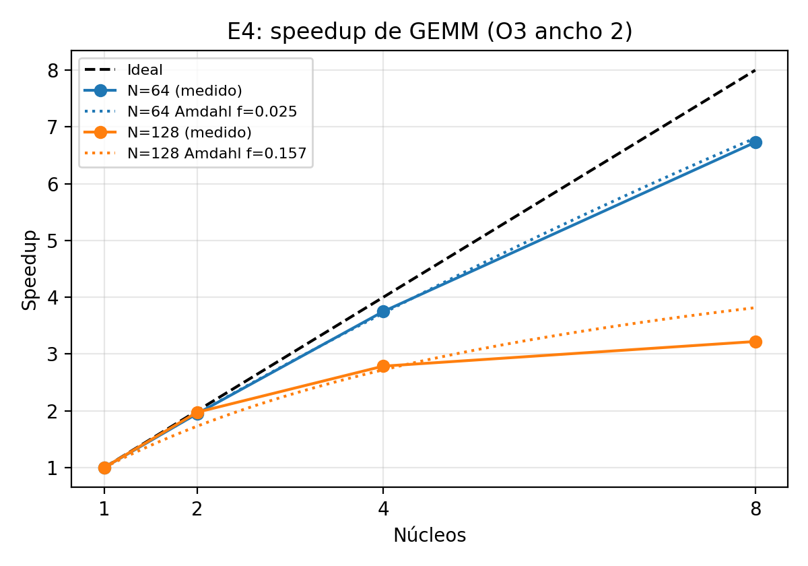

# E4. Escalabilidad del GEMM en un multiprocesador

**Responsable:** Sary Vargas

## Resumen

Se midió cuánto aceleran 1, 2, 4 y 8 núcleos ArmO3CPU (ancho 2) al GEMM paralelo por filas con N = 64 y N = 128. Con N = 64 el *speedup* con 8 núcleos fue de 6,730× (eficiencia de 84,12 %). Con N = 128 fue de 3,221× (eficiencia de 40,26 %). La ley de Amdahl ajustó bien N = 64 (desviación máxima de 1,12 %) y mal N = 128 (18,49 %). Con N = 128 y 8 núcleos, la tasa de fallos de L1D fue de 39,14 %. Una variante con otro orden de bucles (i-k-j), usada solo como comparación, bajó esa tasa a 5,51 % y el tiempo de 1,996 ms a 0,831 ms (2,40×).

## Objetivo y metodología

Se evaluó la escalabilidad del GEMM paralelo, la cual fue efectuada por filas para las matrices de tamaños N = 64 y N = 128. Asimismo, OpenMP distribuyó las
filas completas de la matriz de salida con un hilo por núcleo simulado. A su vez, se usaron 1, 2, 4 y 8 núcleos de ArmO3CPU a una frecuencia de 2 GHz y con un
ancho 2. Por último, la configuración mantuvo un ROB de 192 entradas, una IQ de 64 entradas, cachés L1I y L1D de 32 KiB por núcleo y una caché L2 compartida
de 256 KiB.

Por otra parte, el barrido oficial usó la programación que se encuentra en la ruta `src/gemm_paralelo.c`. Asimismo, las 8 corridas terminaron con el mensaje en
pantalla de `CHECK=PASS`, 0 errores y la cantidad esperada de hilos activos. A su vez, las diversas métricas se extrajeron del primer bloque del archivo
`stats.txt`, el cual corresponde a la región de interés (ROI). De la misma manera, esa región incluye el cálculo y la gestión del equipo de hilos. De la misma
forma, el *speedup* se calculó con la ecuación `T₁ / Tₚ`, donde `T₁` es el tiempo simulado con un núcleo para el mismo tamaño de matriz. Finalmente, la
eficiencia se calculó como el `speedup / p`, donde `p` es el número de núcleos.

### Hardware simulado y métricas

- **Núcleo:** ArmO3CPU a 2 GHz con ancho 2 en las siete etapas del cauce (fetch, decode, rename, dispatch, issue, writeback y commit), ROB de 192 entradas y cola de emisión (IQ) de 64 entradas. Es el mismo núcleo que usan E2 y E3.
- **Memoria:** L1I y L1D de 32 KiB por núcleo (2 vías), L2 compartida de 256 KiB (8 vías), línea de 64 bytes, DDR3-1600 y 512 MiB.
- **Validación:** repetir el barrido completo dio resultados idénticos (gem5 es determinista).
- **Fórmulas:** con `Tₚ` el tiempo de la ROI con `p` núcleos, el *speedup* es `S(p) = T₁ / Tₚ` y la eficiencia es `E(p) = S(p) / p`. La fracción serial se estimó con la ley de Amdahl [1], `1/S(p) = f + (1 − f)/p`, ajustada por mínimos cuadrados sobre `1/S` con p = 2, 4 y 8.
- **Desbalance entre núcleos:** diferencia relativa de los ciclos por núcleo.

## Resultados del barrido oficial

| N | Núcleos | Tiempo de la ROI (ms) | Speedup | Eficiencia | Fallos L2 | Tasa de fallos L2 |
| --- | ---: | ---: | ---: | ---: | ---: | ---: |
| 64 | 1 | 0,821 | 1,000× | 100,00 % | 70 | 0,9515 % |
| 64 | 2 | 0,421 | 1,950× | 97,51 % | 258 | 4,3907 % |
| 64 | 4 | 0,219 | 3,749× | 93,72 % | 349 | 6,6884 % |
| 64 | 8 | 0,122 | 6,730× | 84,12 % | 529 | 8,9117 % |
| 128 | 1 | 6,429 | 1,000× | 100,00 % | 88 | 0,0054 % |
| 128 | 2 | 3,256 | 1,975× | 98,73 % | 402 | 0,0333 % |
| 128 | 4 | 2,307 | 2,787× | 69,67 % | 525 | 0,0433 % |
| 128 | 8 | 1,996 | 3,221× | 40,26 % | 846 | 0,0724 % |

En primer lugar, para un tamaño de N = 64, el *speedup* con 8 núcleos fue de 6,730× frente al ideal de 8×. En segundo lugar, para un tamaño de N = 128, la
ejecución con 2 núcleos se acercó al ideal, pero la eficiencia cayó a 40,26 % con 8 núcleos. Es importante mencionar que, para este último caso, la tasa de
fallos de L1D fue de 39,14 % y se registraron 1 168 442 accesos a la caché L2. A su vez, el desbalance de ciclos entre núcleos fue de 0,92 %. Estas mediciones
apuntan a un costo importante de los diversos accesos a la jerarquía de caché, con muy poca diferencia de ciclos entre los distintos núcleos.



[CSV de métricas](../results/e4/summary/e4_metricas.csv) · [Gráfico de eficiencia](../results/e4/summary/e4_eficiencia.png) · [Resumen completo](../results/e4/summary/e4_resumen.md)

### Análisis de la caída con N = 128

- **No es desbalance de carga:** la diferencia de ciclos entre núcleos fue de 0,92 %.
- **Sí hay mucho tráfico de caché:** con 8 núcleos, la tasa de fallos de L1D fue de 39,14 % y hubo 1 168 442 accesos a L2.
- **Causa más probable:** el programa recorre B por columnas con un paso de 512 bytes (128 elementos de 4 bytes). En una L1D de 2 vías, esas direcciones caen en pocos conjuntos y tienden a expulsarse entre sí (fallos por conflicto) [2]. Esto es compatible con los datos, pero **no se aisló con un experimento de control**, por lo que se presenta como hipótesis.

## Estimación con la ley de Amdahl

Se ajustó el modelo con la ecuación `1/S(p) = f + (1 − f)/p` por mínimos cuadrados sobre el inverso del *speedup* para 2, 4 y 8 núcleos. A su vez, la fracción
serial efectiva `f` fue de **2,51 % para un tamaño de N = 64** y **15,66 % para un tamaño de N = 128**. Asimismo, la máxima desviación relativa del modelo
fue de 1,12 % y 18,49 %, respectivamente.

Para un tamaño de N = 128, la estimación por configuración subió de 1,29 % con 2 núcleos a 21,20 % con 8 núcleos. Por esta razón, el 15,66 % resume el
comportamiento del barrido, pero, a su vez, una fracción serial constante describe de forma limitada las mediciones de ese tamaño en particular.

**Interpretación.** La `f` ajustada no representa solo código secuencial: absorbe cualquier pérdida que crezca con el número de núcleos, como el tráfico de caché [3]. Por eso, con N = 128, la `f` calculada punto por punto cambia con `p` y el modelo se desvía 18,49 %.

## Comparación adicional con la variante i-k-j

La variante de la programación que se encuentra en la ruta `src/gemm_paralelo_ikj.c` mantuvo el reparto por las filas y cambió el orden de los bucles
para poder recorrer de forma contigua las filas de B y C. A su vez, en el caso de una matriz con un tamaño de N = 128 con 8 núcleos, el tiempo simulado pasó de
1,996 ms a 0,831 ms, donde se observa una mejora de 2,40× entre las implementaciones. Asimismo, la tasa de fallos de la caché L1D bajó de un 39,14 % a un 5,51 %
y los accesos a la caché L2 pasaron de 1 168 442 a 21 746, aunque es importante mencionar que el número de fallos de L2 aumentó de 846 a 1 104. De la misma manera,
el *speedup* de la variante, calculado con su propia ejecución de un núcleo, fue de 7,779×.

| Métrica (N = 128, 8 núcleos) | Oficial | Variante i-k-j |
| --- | ---: | ---: |
| Tiempo de la ROI (ms) | 1,996 | 0,831 |
| *Speedup* propio (8 núcleos / 1 núcleo) | 3,221× | 7,779× |
| Eficiencia con 8 núcleos | 40,26 % | 97,2 % |
| Tasa de fallos de L1D | 39,14 % | 5,51 % |
| Accesos a L2 | 1 168 442 | 21 746 |
| Fallos de L2 | 846 | 1 104 |
| Fracción serial ajustada `f` | 15,66 % | 0,36 % |

Los accesos a L2 bajaron unas 54 veces. Cambiar solo el patrón de acceso eliminó la mayor parte de la pérdida, lo que respalda que ese patrón era la causa principal del mal escalamiento. No prueba por sí solo si el mecanismo exacto es de conflicto o de capacidad. La variante **no es el programa oficial del barrido**; se conserva solo como comparación, separada del programa de Steven.

[Tabla comparativa](../results/e4_comparacion/e4_comparacion.md) · [Gráfico comparativo](../results/e4_comparacion/e4_comparacion.png)

## Limitaciones

- Los resultados son simulados y hay una corrida por configuración (la repetición completa coincidió).
- Solo se probaron N = 64 y N = 128, y hasta 8 núcleos.
- La explicación por fallos de conflicto en L1D es una hipótesis compatible con los datos; no se hizo un experimento de control (por ejemplo, aumentar la asociatividad de L1D).
- La variante i-k-j no es el programa oficial. Se usa solo para comparar.

## Conclusión

Con 8 núcleos, el GEMM oficial conservó el 84,12 % de eficiencia para un tamaño de N = 64 y el 40,26 % para un tamaño de N = 128. Asimismo, con el mismo
hardware y el mismo tamaño de N = 128, el haber cambiado el orden de los bucles redujo el tiempo simulado a 0,831 ms. A su vez, la comparación muestra que el
patrón de acceso a memoria influye directamente en cuánto rendimiento se obtiene al agregar los núcleos. En este experimento, ese patrón influyó más en el escalamiento que el número de núcleos: con la variante, la eficiencia con 8 núcleos subió a 97,2 %.

## Reproducción

Desde la raíz del repositorio en Ubuntu, con Docker, la imagen ARM del proyecto, Python 3 y la herramienta Matplotlib instalados, ejecutar el siguiente
comando:

```bash
bash scripts/reproducir_e4.sh
```

También es importante mencionar que el script llama al contenedor para validar y poder simular el experimento. Además, este reutiliza las corridas válidas por
defecto y regenera los archivos CSV, los gráficos correspondientes y la comparación a realizar. Finalmente, la comprobación final muestra en pantalla el
mensaje de `E4 COMPLETO`, para una ejecución del experimento en forma correcta.

[Datos oficiales](../results/e4/) · [Datos de la variante i-k-j](../results/e4_ikj/) · [Registro de reproducción](../results/e4_reproduccion/reproducir.log)

Sección del informe técnico: [report/e4.md](../report/e4.md).

## Referencias

[1] G. M. Amdahl, "Validity of the single processor approach to achieving large scale computing capabilities," en *Proc. AFIPS Spring Joint Computer Conf.*, 1967, pp. 483–485.
[2] J. L. Hennessy y D. A. Patterson, *Computer Architecture: A Quantitative Approach*, 6.ª ed. Morgan Kaufmann, 2019.
[3] M. D. Hill y M. R. Marty, "Amdahl's law in the multicore era," *IEEE Computer*, vol. 41, no. 7, pp. 33–38, 2008.
