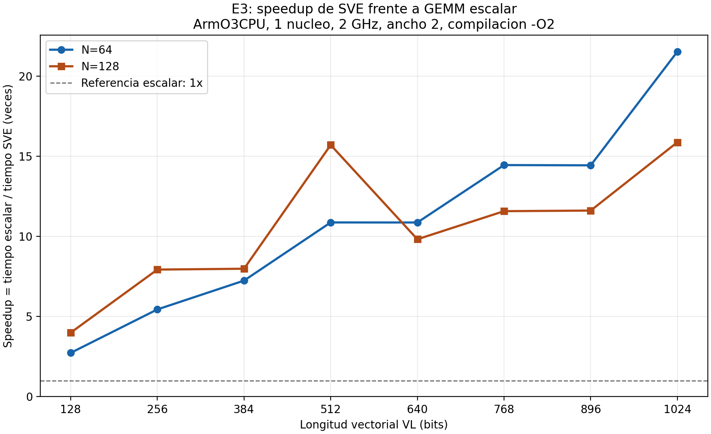

# Experimento E3: extensiones vectoriales SVE

Responsable: Steven Loaiza

## Estado

La implementacion, la validacion funcional, las 32 corridas ejecutadas, los CSV y el grafico de speedup estan publicados en el repositorio.

Asimismo el actual documento presenta el analisis de instrucciones, los diversos ciclos y la escalabilidad. Ademas, incluye una comparacion 
reproducible de los contadores de memoria para un tamano de N=128 con un VL=512 y un VL=640.

Por otra parte, los resultados respaldan una explicacion basada en mayor presion sobre memoria con un VL=640. Tambien es importante mencionar que
no se ha aislado de forma concluyente el mecanismo inicial que produce ese aumento.

## Objetivo

EL objetivo principal es el de comparar GEMM escalar y GEMM SVE para de esta manera poder determinar si la ganancia del rendimiento que se genera
aumenta proporcionalmente con la longitud vectorial.

De la misma manera, se estudian tamano de N=64 y un tamano de N=128 con VL de 128 a 1024 bits, en incrementos de 128 bits cada uno de ellos.

## Condiciones de comparacion

Cada pareja escalar/SVE utiliza el mismo hardware, el cual se presenta a continuacion:

- Un nucleo ArmO3CPU a una frecuencia de 2 GHz.
- Ancho 2 en las etapas configuradas del pipeline.
- ROB de 192 entradas y el IQ de 64 entradas en total.
- L1I y L1D de 32 KiB y 2 vias de asociatividad.
- L2 de 256 KiB y 8 vias de asociatividad.
- Lineas de cache de 64 bytes.

A su vez, ambas versiones utilizan compilacion estatica AArch64 con -O2 y la version SVE utiliza intrinsecos vectoriales.

Finalmente, las metricas corresponden al primer bloque de estadisticas, puesto porque esta delimitado por las operaciones de medicion de la ROI.
La inicializacion y la comprobacion numerica quedan fuera de ella.

## Evidencias

- [Metricas de las 32 corridas](../results/e3/summary/e3_metricas.csv).
- [Comparaciones escalar/SVE](../results/e3/summary/e3_speedup.csv).
- [Grafico en SVG](../results/e3/figures/e3_speedup_vs_vl.svg).
- [Codigo SVE conservado con una corrida](../results/e3/n128/vl640/sve/gemm_sve.c).



## Definicion de las metricas

El tiempo simulado se obtiene con la siguiente ecuacion:

tiempo_ROI = simTicks / simFreq

El speedup se calcula para el mismo N y VL de la siguiente manera:

speedup = tiempo_escalar / tiempo_SVE

Asimismo, un valor mayor que 1 indica que SVE tarda menos que la version escalar. De forma similar, es importante mencionar que ambas versiones
utilizan la misma frecuencia, la razon de ciclos coincide con la razon de tiempos.

Por otra parte, la reduccion de instrucciones se calcula con la siguiente ecuacion:

reduccion_pct = 100 * (1 - instrucciones_SVE / instrucciones_escalar)

## Resultados de speedup

| VL en bits | N=64 | N=128 |
| --- | --- | --- |
| 128 | 2.727 | 3.987 |
| 256 | 5.439 | 7.926 |
| 384 | 7.238 | 7.979 |
| 512 | 10.868 | 15.703 |
| 640 | 10.865 | 9.819 |
| 768 | 14.449 | 11.572 |
| 896 | 14.434 | 11.609 |
| 1024 | 21.529 | 15.874 |

Es importante mencionar que los valores estan redondeados a tres decimales cada uno de ellos.

SVE mejora el tiempo frente a la referencia escalar en las
16 comparaciones. Sin embargo, aumentar VL no produce una
mejora proporcional ni estrictamente creciente en todos los casos.

## N=64: bloques de columnas y mesetas

Cada elemento float ocupa 32 bits. Por ello, la cantidad de
elementos por vector es VL / 32.

El codigo avanza por grupos de columnas del tamano obtenido
con svcntw(). El numero de grupos por fila es:

grupos_por_fila = techo(N / (VL / 32))

El predicado del ultimo grupo desactiva las posiciones que
quedan fuera de la matriz.

| VL | Elementos por vector | Grupos por fila para N=64 | Instrucciones SVE | Ciclos SVE |
| --- | --- | --- | --- | --- |
| 512 | 16 | 4 | 134166 | 103095 |
| 640 | 20 | 4 | 134166 | 103129 |
| 768 | 24 | 3 | 100758 | 77545 |
| 896 | 28 | 3 | 100758 | 77628 |
| 1024 | 32 | 2 | 67350 | 52044 |

Pasar de VL=512 a VL=640 mantiene cuatro grupos por fila.
Pasar de VL=768 a VL=896 mantiene tres grupos por fila.

Esto explica por que esos aumentos de VL no reducen el numero
de iteraciones de grupos. Las instrucciones medidas son iguales
dentro de cada pareja y los ciclos son muy similares.

Esta estructura del algoritmo explica las mesetas principales.
No identifica por si sola la causa de las pequenas diferencias
de ciclos entre configuraciones con igual numero de instrucciones.

## N=128: menos instrucciones no garantiza menos ciclos

La comparacion entre VL=512 y VL=640 muestra:

| Metrica SVE | VL=512 | VL=640 |
| --- | --- | --- |
| Instrucciones | 1059862 | 927510 |
| Ciclos | 921522 | 1473805 |
| Tiempo en segundos | 0.000460761 | 0.0007369025 |
| Speedup frente a escalar | 15.703 | 9.819 |
| Ciclos / instrucciones | 0.869 | 1.589 |

Al pasar de un VL=512 a un VL=640, se tiene los siguientes factores:

- Las instrucciones disminuyen aproximadamente un 12.49%.
- Los ciclos aumentan aproximadamente un 59.93%.
- El speedup disminuye aproximadamente un 37.47%.

Por tanto, la reduccion del trabajo expresado como instrucciones no se convierte en forma automatica en una reduccion de tiempo. Asimismo, el 
costo medio observado por instruccion aumenta.

De la misma manera, los CSV resumidos no permiten atribuir esta caida a una causa especifica o puntual, como lo pueden ser los fallos de cache, 
los accesos que cruzan las diversas lineas o las distintas esperas de ejecucion.

## Comparacion reproducible de memoria para un tamano de N=128

El script de la ruta: `scripts/comparar_memoria_e3.py` compara 8 metricas del primer bloque de ROI de las corridas SVE con un VL=512 y un VL=640.

A su vez, antes de escribir el CSV, este reutiliza las comprobaciones de `parse_stats.py`: validation.txt no vacio, CHECK=PASS con errores=0 y 
primer bloque completo. Ademas, este rechaza las metricas ausentes, duplicadas o con valores invalidos.

Desde la raiz del repositorio, en Ubuntu colocar los siguiente comandos:

```bash
# Regenerar la comparacion usando las estadisticas existentes.
python3 scripts/comparar_memoria_e3.py
```

Este script reemplaza solamente su CSV derivado. El mismo no modifica las estadisticas originales ni ejecuta nada en el simulador gem5.

[CSV de la comparacion](../results/e3/summary/e3_memoria_n128_vl512_vs_vl640.csv).

### Resultados

| Metrica | VL=512 | VL=640 |
| --- | --- | --- |
| Instrucciones | 1059862 | 927510 |
| Ciclos CPU | 921522 | 1473805 |
| Accesos de demanda L1D | 264582 | 329746 |
| Fallos de demanda L1D | 138959 | 219763 |
| Tasa de fallos L1D | 52.5202% | 66.6461% |
| Eventos de bloqueo por cache en LSQ | 125025 | 213893 |
| Eventos de cola de cargas llena | 22628 | 569086 |
| Fallos de demanda L2, total | 43 | 45 |

A partir de la anterior tabla se observa que el CSV conserva los nombres exactos de las estadisticas. Ademas, la tasa de fallos se almacena 
como una razon entre 0 y 1. Finalmente, los fallos de demanda totales de L2 incluyen los datos e instrucciones.

### Interpretacion y alcance

En primer lugar, con un VL=640 se disminuyen las instrucciones, pero a su vez se aumentan los accesos y fallos de L1D. Asimismo, tambien aumentan
los eventos de acceso bloqueados por cache y de bloqueo de rename por la cola de cargas llena.

En segundo lugar, estos contadores respaldan una explicacion de la perdida de rendimiento puesto que la misma esta relacionada con una mayor presion 
sobre la memoria y sobre los distintos recursos que mantienen cargas pendientes.

En tercer lugar, los fallos de demanda de L2 pasan de 43 a 45. A su vez, esta comparacion no respalda el poder atribuir la caida a un gran aumento 
del numero de fallos en L2, pero tampoco se puede descartar otros costos de acceso o de contencion.

En cuarto lugar, los eventos de bloqueo no son ciclos perdidos. Por esta razon, estos no se deben sumar ni convertirse directamente en porcentajes 
del tiempo de ejecucion.

En quinto lugar, la comparacion manual de los archivos config.ini publicados se encontro diferencias en la longitud vectorial y en las rutas de ejecucion
de los mismos, sin cambios en los demas parametros. A su vez, el nuevo script extrae las distintas estadisticas, pero no automatiza esa comparacion de 
configuraciones.

En sexto lugar, una posible explicacion del aumento de accesos que se logro evidenciar es su distribucion entre las diversas lineas de cache. Un vector 
de 512 bits contiene 64 bytes, mientras que uno de 640 bits llega a contener 80 bytes, frente a lineas configuradas de 64 bytes.

Finalmente, esta observacion no demuestra cuantos accesos se dividen: puesto que tambien intervienen la alineacion, los elementos activos y la 
implementacion de las operaciones vectoriales en el simulador gem5. Por la anterior explicacion se concluye que la causa exacta permanece como una incertidumbre.

### Evidencias originales

- [Estadisticas VL=512](../results/e3/n128/vl512/sve/stats.txt).
- [Estadisticas VL=640](../results/e3/n128/vl640/sve/stats.txt).
- [Configuracion VL=512](../results/e3/n128/vl512/sve/config.ini).
- [Configuracion VL=640](../results/e3/n128/vl640/sve/config.ini).

## Conclusiones iniciales

1. SVE reduce el tiempo respecto a su referencia escalar en todas las configuraciones estudiadas y analizadas.

2. El mayor speedup que fue medido dentro del barrido ocurre con la siguiente configuracion de un VL=1024: 21.529 para un tamano de N=64 y 
   15.874 para un tamano de N=128. Asimismo, estos valores no establecen un maximo fuera del rango medido.

3. La ganancia no escala de forma estrictamente proporcional con VL. Puesto que para el tamano de N=64, el numero entero de grupos de columnas
   explica las principales zonas de estabilizacion de la grafica.

4. Para un tamano de N=128, la caida entre un VL=512 y un VL=640 demuestra que el contar las instrucciones no basta para predecir los ciclos.

5. Asimismo, estos resultados corresponden al programa y al modelo de hardware simulados, los mismos no representan una medicion de un 
   procesador ARM en formato fisico.

## Pendientes para cerrar el analisis

- Revisar las conclusiones finales, separando la evidencia de mayor presion sobre la memoria de las hipotesis sobre su posible origen.
- Integrar la regeneracion de CSV y las distitnas figuras en un solo comando.

Finalmente, como un procedimiento extra, se puede aislar el efecto de la alineacion y de los distintos accesos que cruzan lineas. Asimismo, esta comprobacion
adicional no se presenta como una exigencia explicita en el enunciado del proyecto (HTML).

## Referencia tecnica del enunciado

Arm C Language Extensions (ACLE), esta es una referencia incluida en el HTML del enunciado del proyecto:

https://github.com/ARM-software/acle

Documentacion:

https://arm-software.github.io/acle/main/acle.html
