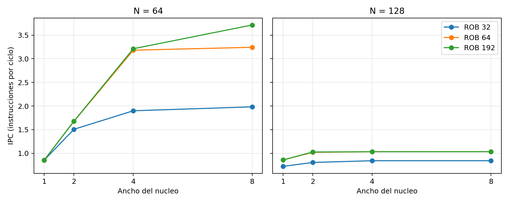

# E2 - Arquitectura superescalar

## Objetivo y metodo

Se evaluo en que punto se aumenta el ancho de un nucleo ArmO3CPU deja de mejorar el factor de IPC del GEMM escalar. Para esto se utilizo un nucleo a 2 GHz,
una IQ de 64 entradas, anchos de 1, 2, 4 y 8 y un ROB de 32, 64 o 192 entradas. Finalmente, se analizaron y observaron tamanos de N=64 y de N=128, para 
un total de 24 corridas ejecutadas.

## Resultados principales

Para un tamano de N=64 y ancho 8, el aumentar el ROB de 32 a 192 entradas aumento el factor de IPC de un 1.983104 a un 3.714634. Por otra parte, para un tamano
de N=128 y un ROB de 64 entradas, el aumentar el de ancho de 4 a ancho de 8 solamente cambio el factor de IPC de un 1.033379 a un 1.033452. Finalmente, el conteo
de los saltos mal realizados se mantuvo constante dentro de cada uno de los tamanos.

## Aporte a E6

En el caso especifico de un tamano de N=128 y un ROB de 64 entradas, los anchos 2, 4 y 8 obtuvieron un IPC de 1.020515, 1.033379 y 1.033452 respectivamente. 
A su vez, estos resultados justifican incluir anchos de 2 y de 4 entre los candidatos del experimento E6 antes de poder dedicar mas presupuesto al ancho 8 en
especifico. FInalmente, la decision dependera de los tiempos y costos del experimento E6.

[Analisis y mediciones de E2](../docs/experimento_superescalar.md)
