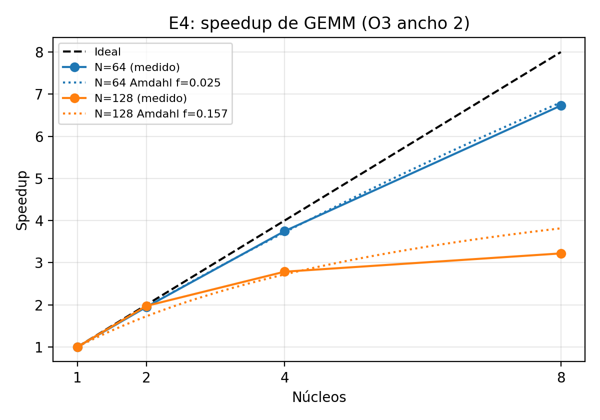

# E4. Escalabilidad del GEMM en un multiprocesador

**Responsable:** Sary Vargas

## Objetivo y metodología

Se evaluo la escalabilidad del GEMM paralelo la cual fue efectuada por filas para las matrices de tamaños N = 64 y de N = 128. Asimismo OpenMP distribuyo las
filas completas de la matriz de salida con un hilo por nucleo simulado. A su vez, se usaron 1, 2, 4 y 8 nucleos de ArmO3CPU a una frecuencia de 2 GHz y con un
ancho 2. Por ultimo, la configuracion mantuvo un ROB de 192 entradas, una IQ de 64 entradas, caches L1I y L1D de 32 KiB por nucleo y una cache L2 compartida
de 256 KiB.

Por otra parte, el barrido oficial uso la programacion que se encuentra en la ruta `src/gemm_paralelo.c`. Asimismo, las 8 corridas terminaron con el mensaje en
pantalla de `CHECK=PASS`, 0 errores y la cantidad esperada de hilos activos. A su vez, las diversas metricas se extrajeron del primer bloque del archivo
`stats.txt` el cual corresponde a la region de interes (ROI). De la misma manera, esa region incluye el calculo y la gestion del equipo de hilos. De la misma
forma. el *speedup* se calculo con la ecuacion: `T₁ / Tₚ`, donde `T₁` es el tiempo simulado con un nucleo para el mismo tamaño de matriz. Finalmente, la
eficiencia se calculo como el `speedup / p`, donde `p` es el numero de nucleos.

## Resultados del barrido oficial

| N | Nucleos | Tiempo de la ROI (ms) | Speedup | Eficiencia | Fallos L2 | Tasa de fallos L2 |
| --- | ---: | ---: | ---: | ---: | ---: | ---: |
| 64 | 1 | 0,821 | 1,000× | 100,00 % | 70 | 0,9515 % |
| 64 | 2 | 0,421 | 1,950× | 97,51 % | 258 | 4,3907 % |
| 64 | 4 | 0,219 | 3,749× | 93,72 % | 349 | 6,6884 % |
| 64 | 8 | 0,122 | 6,730× | 84,12 % | 529 | 8,9117 % |
| 128 | 1 | 6,429 | 1,000× | 100,00 % | 88 | 0,0054 % |
| 128 | 2 | 3,256 | 1,975× | 98,73 % | 402 | 0,0333 % |
| 128 | 4 | 2,307 | 2,787× | 69,67 % | 525 | 0,0433 % |
| 128 | 8 | 1,996 | 3,221× | 40,26 % | 846 | 0,0724 % |

En primer lugar para un tamano de N = 64, el *speedup* con 8 nucleos fue de 6,730× frente al ideal de 8×. En segundo lugar, para un tamano de N = 128, la
ejecucion con 2 nucleos se acerco al ideal, pero la eficiencia cayo a 40,26 % con 8 nucleos. Es importante mencionar que para este ultimo caso, la tasa de
fallos de L1D fue de 39,14 % y se registraron 1 168 442 accesos a la cache L2. A su vez, el desbalance de ciclos entre nucleos fue de 0,92 %. Estas mediciones
apuntan a un costo importante de los diversos accesos a la jerarquia de cache teniendo muy poca diferencia de ciclos entre los distintos nucleos.



[CSV de métricas](../results/e4/summary/e4_metricas.csv) · [Gráfico de eficiencia](../results/e4/summary/e4_eficiencia.png) · [Resumen completo](../results/e4/summary/e4_resumen.md)

## Estimacion con la ley de Amdahl

Se ajusto el modelo con la ecucacion: `1/S(p) = f + (1 − f)/p` por mínimos cuadrados sobre el inverso del *speedup* para 2, 4 y 8 nucleos. A su vez, la fracción
serial efectiva `f` fue de **2,51 % para un tamano de N = 64** y **15,66 % para un tamano de N = 128**. Asimismo, la maxima desviacion relativa del modelo
fue de 1,12 % y 18,49 %, respectivamente.

Para un tamano de N = 128, la estimacion por la configuracion subio de un 1,29 % con 2 nucleos a 21,20 % con 8 nucleos. Por esta razon, el 15,66 % resume el
comportamiento del barrido, pero a su vez, una fraccion serial constante describe de forma limitada las mediciones de ese tamano en particular.

## Comparacion adicional con la variante i-k-j

La variante de la programacion que se encuentra en la ruta `src/gemm_paralelo_ikj.c` mantuvo el reparto por las filas y la misma cambio el orden de los bucles
para poder recorrer de forma contigua las filas de B y C. A su vez, en el caso de una matriz con un tamano de N = 128 con 8 nucleos, el tiempo simulado paso de
1,996 ms a 0,831 ms, donde se observa una mejora de 2,40× entre las implementaciones. Asimismo, la tasa de fallos de la cache L1D bajo de un 39,14 % a un 5,51 %
y los accesos a la cache L2 pasaron de 1 168 442 a 21 746, aunque es importante mencionar que el numero de fallos de L2 aumento de 846 a 1 104. De la misma manera,
el *speedup* de la variante calculado con su propia ejecucion de un nucleo fue de 7,779×.

[Tabla comparativa](../results/e4_comparacion/e4_comparacion.md) · [Gráfico comparativo](../results/e4_comparacion/e4_comparacion.png)

## Conclusion

Con 8 núcleos, el GEMM oficial conservó el 84,12 % de eficiencia para un tamano de N = 64 y el 40,26 % para un tamano de N = 128. Asimismo, con el mismo
hardware y el mismo tamaño de N = 128, el haber cambiado el orden de los bucles redujo el tiempo simulado a 0,831 ms. A su vez, la comparación muestra que el
patron de acceso a memoria influye directamente en cuanto rendimiento se obtiene al agregar los nucleos.

## Reproduccion

Desde la raíz del repositorio en Ubuntu, con el Docker, la imagen ARM del proyecto, Python 3 y la herramienta Matplotlib instalados, ejecutar el siguiente
comando:

```bash
bash scripts/reproducir_e4.sh
```

Tambien es importante mencionar, que el script llama al contenedor para validar y poder simular el experimento. Ademas este reutiliza las corridas validas por
defecto y regenera los archivos CSV, los graficos correspondientes y la comparacion a realizar. Finalmente, la comprobación final muestra en pantalla el
mensaje de `E4 COMPLETO`, para una ejecucion del experimento en forma correcta.

[Datos oficiales](../results/e4/) · [Datos de la variante i-k-j](../results/e4_ikj/) · [Registro de reproducción](../results/e4_reproduccion/reproducir.log)
