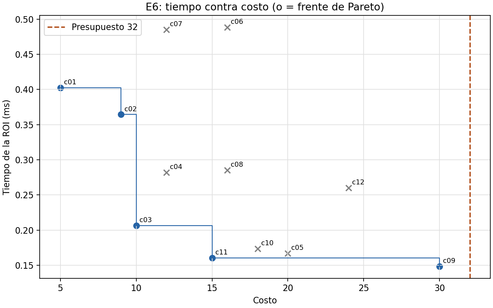

# E6. Exploración de configuraciones bajo presupuesto

**Responsable:** Sary Vargas 

## Objetivo y metodología

Se buscó la mejor configuración de procesador para el GEMM con SVE y varios núcleos bajo un presupuesto de costo. El costo de una configuración se calculó con la fórmula del enunciado:

`Costo = N_núcleos × (W_issue / 2 + VL / 128)`, con presupuesto máximo de 32.

Se evaluaron 12 configuraciones con N = 128 (tamaño pedido) y, como sensibilidad, con N = 256. Cada una se eligió con una hipótesis basada en los experimentos anteriores (columna de justificación en `configs/e6_configuraciones.csv`). Todas usaron ArmO3CPU a 2 GHz, ROB de 192 entradas, IQ de 64, todas las etapas con el mismo ancho, L1I y L1D de 32 KiB por núcleo y una L2 compartida de 256 KiB (igual que E2, E3 y E4).

El programa es `src/gemm_paralelo_sve.c`: mismo algoritmo y mismas fórmulas de inicialización que `src/gemm_sve.c` (E3), con OpenMP repartiendo filas de C entre los hilos (un hilo por núcleo simulado). Las métricas salen del primer bloque de `stats.txt` (la ROI). Cada corrida terminó con `CHECK=PASS`, 0 errores y la cantidad esperada de hilos activos. El análisis comprueba además en `config.ini` que cada corrida usó los núcleos, el ancho y el VL pedidos.

Métricas: `rendimiento/costo = 1 / (tiempo en ms × costo)`; `speedup` frente a c01 (1 núcleo, ancho 2, VL512); frente de Pareto sobre (costo, tiempo).

## Protocolo de coherencia

Las 24 corridas usan la jerarquía de caches clásica de gem5 (igual que E4) y no Ruby. La decisión se apoya en los datos de E5 con el GEMM paralelo (Ruby, 2 a 8 núcleos): MESI fue más rápido o igual que MOESI en los 14 pares medidos. Con N = 128 el cociente MOESI/MESI fue 1,42 con 2 núcleos (22,69 ms contra 15,94 ms) y 1,47 con 8 núcleos (6,10 ms contra 4,15 ms); con N = 64 fue entre 1,000 y 1,005. Además, el reparto por filas con memoria alineada a 64 bytes hace que cada fila de C (N × 4 bytes, múltiplo de 64) empiece en una línea de cache distinta, así que los hilos no escriben en una misma línea. Por eso el falso compartido, donde E5 mostró diferencias entre protocolos, no es el factor que decide en este kernel. Esto es un argumento con datos de otro experimento: no se midió el kernel SVE de E6 con Ruby.

## Configuraciones evaluadas

| Config | Núcleos | Ancho | VL | Costo | Motivo de la elección |
| --- | ---: | ---: | ---: | ---: | --- |
| c01 | 1 | 2 | 512 | 5 | Base. En E3 (N=128) VL512 dio 15,70× sobre el escalar |
| c02 | 1 | 2 | 1024 | 9 | En E3 VL1024 apenas mejoró a VL512 (0,456 ms contra 0,461 ms) |
| c03 | 2 | 2 | 512 | 10 | Escala c01; en E4 el acceso por filas dio 1,99× con 2 núcleos |
| c04 | 4 | 2 | 256 | 12 | En E3 VL256 ≈ VL384 con menor costo |
| c05 | 4 | 2 | 512 | 20 | VL512 con 4 núcleos |
| c06 | 8 | 2 | 128 | 16 | Máximo paralelismo con vector mínimo |
| c07 | 8 | 1 | 128 | 12 | En E2 ancho 1 dio IPC 0,859 contra 1,027 de ancho 2 |
| c08 | 4 | 4 | 256 | 16 | En E2 ancho 4 casi no mejoró a ancho 2 (IPC 1,0325) |
| c09 | 6 | 2 | 512 | 30 | Mayor configuración con VL512 dentro del presupuesto |
| c10 | 2 | 2 | 1024 | 18 | Comparar VL1024 con 2 núcleos contra c05 |
| c11 | 3 | 2 | 512 | 15 | Punto intermedio con costo ≤ 16 |
| c12 | 8 | 2 | 256 | 24 | Ver si la L2 compartida limita antes que el cómputo |

## Resultados con N = 128 (presupuesto 32)

| Config | Núcleos | Ancho | VL | Costo | Tiempo ROI (ms) | Rend./costo | Speedup vs c01 | Fallos L1D (%) |
| --- | ---: | ---: | ---: | ---: | ---: | ---: | ---: | ---: |
| c09 | 6 | 2 | 512 | 30 | 0,1485 | 0,2245 | 2,71 | 39,4 |
| c11 | 3 | 2 | 512 | 15 | 0,1607 | 0,4149 | 2,50 | 42,4 |
| c05 | 4 | 2 | 512 | 20 | 0,1670 | 0,2995 | 2,41 | 41,5 |
| c10 | 2 | 2 | 1024 | 18 | 0,1736 | 0,3201 | 2,32 | 54,6 |
| c03 | 2 | 2 | 512 | 10 | 0,2064 | 0,4845 | 1,95 | 42,7 |
| c12 | 8 | 2 | 256 | 24 | 0,2601 | 0,1602 | 1,55 | 38,8 |
| c04 | 4 | 2 | 256 | 12 | 0,2822 | 0,2953 | 1,43 | 40,6 |
| c08 | 4 | 4 | 256 | 16 | 0,2851 | 0,2192 | 1,41 | 40,0 |
| c02 | 1 | 2 | 1024 | 9 | 0,3643 | 0,3050 | 1,10 | 53,9 |
| c01 | 1 | 2 | 512 | 5 | 0,4023 | 0,4971 | 1,00 | 42,3 |
| c07 | 8 | 1 | 128 | 12 | 0,4849 | 0,1718 | 0,83 | 39,8 |
| c06 | 8 | 2 | 128 | 16 | 0,4882 | 0,1280 | 0,82 | 38,8 |

- **Menor tiempo:** c09 (6 núcleos, ancho 2, VL512), 0,1485 ms, costo 30.
- **Mejor rendimiento/costo:** c01 (1 núcleo, ancho 2, VL512), 0,4971, costo 5. La segunda es c03, con 0,4845.
- **Frente de Pareto:** c01, c02, c03, c11 y c09.



[CSV completo](../results/e6/n128/summary/e6_resultados.csv) · [Resumen](../results/e6/n128/summary/e6_resumen.md) · [Gráfico de rendimiento/costo](../results/e6/n128/summary/e6_rendimiento_costo.png)

## Análisis de lo observado

1. **El VL rindió más que los núcleos.** c03 (2 núcleos, VL512, costo 10) fue más rápida que c12 (8 núcleos, VL256, costo 24), que c04, c08, c06 y c07. Incluso c01 (1 núcleo) fue 1,21 veces más rápida que c06 (8 núcleos con VL128).
2. **Los núcleos escalaron poco.** Con VL512 el speedup fue 1,95 con 2 núcleos (97,5 % de eficiencia), 2,50 con 3 (83,4 %), 2,41 con 4 (60,2 %) y 2,71 con 6 (45,2 %).
3. **Con N = 256, 4 y 6 núcleos empataron.** c05 y c09 dieron 1,5835 ms y 1,5834 ms. El reparto estático da 64 filas por hilo con 4 núcleos y 43 con 6, así que si el tiempo dependiera solo del cómputo, 6 núcleos serían cerca de 1,5 veces más rápidos. No ocurrió, lo que apunta a que el límite está fuera de los núcleos. Es compatible con una L2 o memoria compartidas saturadas, pero este experimento no lo comprueba.
4. **El ancho casi no importó.** Con 8 núcleos y VL128, ancho 1 contra ancho 2 dio 0,4849 ms contra 0,4882 ms (N = 128) y 4,3676 ms contra 4,3508 ms (N = 256). Con 4 núcleos y VL256, ancho 4 contra ancho 2 dio 0,2851 ms contra 0,2822 ms y 2,9802 ms contra 3,0419 ms. Las diferencias son de 2 % o menos, pero el ancho 4 cuesta 33 % más. Esto es coherente con E2, donde pasar de ancho 2 a 4 subió el IPC solo 0,5 % con N = 128.
5. **La tasa de fallos de L1D fue alta (39 % a 55 %) en todas las configuraciones.** Con N = 128, B ocupa 64 KiB, el doble de la L1D de 32 KiB, así que cada fila de C vuelve a recorrer B desde la L2. Con VL1024 la tasa subió a 54 %, lo que coincide con lo visto en E3 al aumentar el VL.
6. **VL1024 contra VL512 con un núcleo.** c02 fue 9,4 % más rápida que c01 en N = 128 (0,3643 ms contra 0,4023 ms) y 8,2 % en N = 256, con 80 % más de costo (9 contra 5). En E3 la diferencia había sido de 1 %.

## Sensibilidad

### Presupuesto 16 (N = 128)

Se filtraron las mismas corridas con costo ≤ 16 (8 configuraciones): c01, c02, c03, c04, c06, c07, c08 y c11.

- **Menor tiempo:** c11 (3 núcleos, ancho 2, VL512), 0,1607 ms, costo 15. Es solo 8 % más lenta que c09, que cuesta el doble.
- **Mejor rendimiento/costo:** c01, igual que con presupuesto 32.
- **Frente de Pareto:** c01, c02, c03 y c11.

[Resumen con presupuesto 16](../results/e6/n128/summary/e6_resumen_p16.md)

### Tamaño N = 256 (presupuesto 32)

| Config | Costo | Tiempo ROI (ms) | Rend./costo | Speedup vs c01 | Fallos L1D (%) |
| --- | ---: | ---: | ---: | ---: | ---: |
| c09 | 30 | 1,5834 | 0,0211 | 3,78 | 51,7 |
| c05 | 20 | 1,5835 | 0,0316 | 3,78 | 54,2 |
| c12 | 24 | 2,2156 | 0,0188 | 2,70 | 53,2 |
| c10 | 18 | 2,7130 | 0,0205 | 2,21 | 68,9 |
| c11 | 15 | 2,9630 | 0,0225 | 2,02 | 51,6 |
| c08 | 16 | 2,9802 | 0,0210 | 2,01 | 53,2 |
| c04 | 12 | 3,0419 | 0,0274 | 1,97 | 53,3 |
| c03 | 10 | 3,0424 | 0,0329 | 1,97 | 53,8 |
| c06 | 16 | 4,3508 | 0,0144 | 1,38 | 52,7 |
| c07 | 12 | 4,3676 | 0,0191 | 1,37 | 52,9 |
| c02 | 9 | 5,4951 | 0,0202 | 1,09 | 68,5 |
| c01 | 5 | 5,9835 | 0,0334 | 1,00 | 52,9 |

Con N = 256 la mejor configuración por rendimiento/costo sigue siendo c01 (0,0334), seguida de c03 (0,0329). Cambia la de menor tiempo con costo moderado: c05 (4 núcleos, costo 20) iguala a c09 (costo 30). Con N = 256, c11 (3 núcleos) queda en la quinta posición, mientras que con N = 128 era la segunda.

N = 1024 no se simuló: implica unas 512 veces el trabajo de N = 128 y no era viable en el tiempo disponible. Por eso N = 256 es solo un indicio de tendencia, no una medición de N = 1024.

## Propuesta

La configuración que proponemos es **c03: 2 núcleos, ancho 2, VL512, costo 10**, por estas razones medidas:

- Fue la segunda mejor en rendimiento/costo con N = 128 (0,4845) y con N = 256 (0,0329), a menos de 3 % de la primera.
- Estuvo en el frente de Pareto con N = 128 y con N = 256, y con presupuesto 16 y 32.
- Tuvo una eficiencia de 97,5 % (N = 128) y 98,4 % (N = 256), la mayor entre las configuraciones de VL512 con varios núcleos.

Alternativas según el objetivo:

| Objetivo | Configuración | Motivo |
| --- | --- | --- |
| Solo importa rendimiento/costo | c01 (costo 5) | Primera con ambos N y ambos presupuestos |
| Menor tiempo con costo ≤ 16 | c11 (costo 15) | 0,1607 ms con N = 128 |
| Menor tiempo con costo ≤ 32 | c09 (costo 30) | 0,1485 ms con N = 128; con N = 256 c05 le iguala con 2/3 del costo |

La decisión final es del equipo. Los datos no indican que gastar más de 20 de costo ayude con estos tamaños.

## Limitaciones

- Las corridas son simuladas y de una por configuración. gem5 es determinista: en E4 las repeticiones dieron números idénticos, pero en E6 no se repitió cada configuración.
- Solo se probaron N = 128 y N = 256, y 12 de las muchas combinaciones posibles.
- **Control de alineación (c01 y c02, N = 128, 1 núcleo).** El tiempo de c01 con memoria alineada a 64 bytes (0,4023 ms) es 13 % menor que el de E3 (0,4608 ms) con el mismo VL. Para aislar la causa se recompiló el mismo programa de E6 cambiando solo `aligned_alloc(64)` por `malloc` (`-DE6_SIN_ALINEAR`). Resultado: c01 pasó de 0,4023 ms a 0,7144 ms (1,78 veces más lento) y la tasa de fallos de L1D de 42,3 % a 53,0 %; c02 pasó de 0,3643 ms a 0,5336 ms (1,46 veces) y de 53,9 % a 59,6 %. Es decir, la alineación por sí sola cambia el tiempo hasta 1,78 veces y explica que la tasa de fallos de L1D de E3 (52,5 %) sea parecida a la del control sin alinear (53,0 %). Pero el control sin alinear (0,7144 ms) tampoco reproduce el tiempo de E3 (0,4608 ms), así que la alineación no explica por sí sola la diferencia. La diferencia restante puede venir de la posición que `malloc` da a cada matriz, de la región OpenMP o de las banderas de compilación; no se aisló. Consecuencia: los tiempos absolutos de E6 corresponden a matrices alineadas a 64 bytes y no son directamente comparables con los de E3. Las comparaciones entre configuraciones de E6 siguen siendo válidas porque todas usan el mismo programa y la misma alineación.
- La explicación de saturación de L2 o memoria compartida es una hipótesis. No se hizo un experimento de control (por ejemplo, variar el tamaño de la L2).
- N = 1024 no se midió.
- El protocolo de coherencia no se varió en E6 (ver la sección de protocolo); la elección de MESI se apoya en E5.

## Control de alineación

| Programa | c01 (ms) | c01 fallos L1D | c02 (ms) | c02 fallos L1D |
| --- | ---: | ---: | ---: | ---: |
| E6 con memoria alineada a 64 bytes | 0,4023 | 42,3 % | 0,3643 | 53,9 % |
| E6 con `malloc` (control) | 0,7144 | 53,0 % | 0,5336 | 59,6 % |
| E3 (`gemm_sve.c`, `malloc`) | 0,4608 | 52,5 % | 0,4558 | no medido |

[Resumen del control](../results/e6_control/malloc/n128/summary/e6_resumen.md)

## Reproducción

Desde la raíz del repositorio en Ubuntu, con Docker, la imagen ARM del proyecto, Python 3 y Matplotlib:

```bash
bash scripts/arm_env.sh bash scripts/reproducir_e6.sh
```

El script valida el modelo de costo, compila el kernel, comprueba que contiene instrucciones SVE, corre las 24 simulaciones (12 configuraciones × 2 tamaños), genera los CSV, los gráficos y el resumen, y guarda los hashes en `results/e6/reproduccion/`. Termina con `REPRODUCCION_E6_OK`. Reutiliza las corridas que ya están validadas.

[Datos](../results/e6/) · [Configuraciones](../configs/e6_configuraciones.csv) · [Programa](../src/gemm_paralelo_sve.c) · [Registro](../results/e6_reproducir.log)

## Referencias

[1] R. Jain, *The Art of Computer Systems Performance Analysis*. Wiley, 1991.
[2] J. L. Hennessy y D. A. Patterson, *Computer Architecture: A Quantitative Approach*, 6.ª ed. Morgan Kaufmann, 2019, cap. 1 (costo y rendimiento).
[3] Demás referencias (gem5, SVE, OpenMP): ver [report/e6.md](../report/e6.md).
